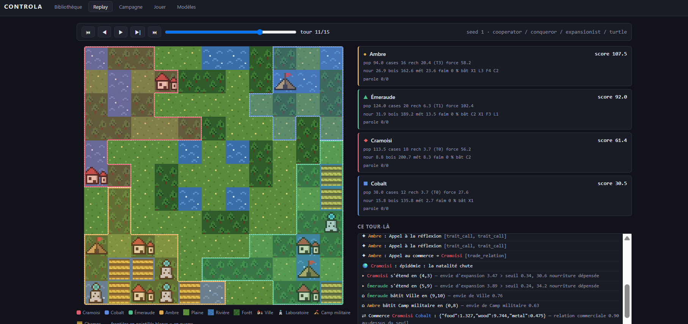
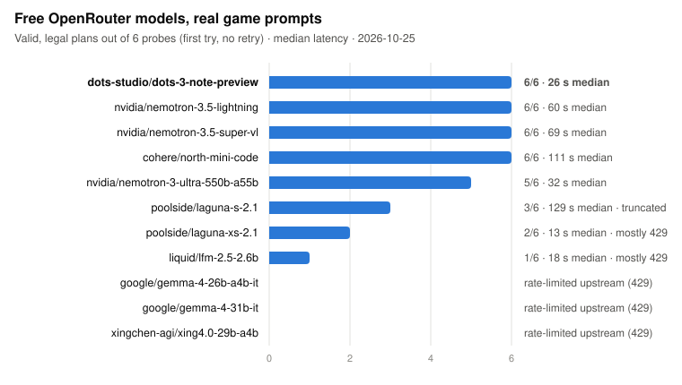

# Controla

*[English summary](README.md)*

Arène **god-4X pour benchmark de LLM** : quatre dieux, chacun piloté par un modèle,
règnent sur un peuple semi-autonome et s'affrontent sur une petite carte.

Ce qu'on mesure : la **cohérence stratégique long-horizon**, le raisonnement sous
incertitude, et surtout la **théorie de l'esprit** — négocier, anticiper, honorer ou
trahir. Le projet est un banc d'essai, pas un jeu commercial.

L'arène est une vraie arène de reinforcement learning : `pettingzoo.utils.env.AECEnv`,
espaces `gymnasium`, espace d'action plat masqué, reward, seeding auditable. Un agent
RL, une policy scriptée et un LLM s'y branchent par la même interface.

Les renvois `§n` désignent les sections de la spec de conception d'origine (non
publiée ici). Les écarts assumés et les mesures d'équilibrage sont dans
[`docs/FINDINGS.md`](docs/FINDINGS.md).

---



## Les deux principes qui portent tout

**1. Le dieu agit DIRECTEMENT sur le monde, INDIRECTEMENT sur son peuple.**
Ses miracles frappent les cases. Sur son peuple, il ne donne **aucun ordre** : il
incline des *traits*, et le peuple agit de lui-même dans la passe de développement.

**2. Le peuple est non-agentique.** Aucun autopilote, aucune seconde IA. Ce qui
ressemble à « le peuple agit » n'est que des règles plus l'aléa de la passe. Mais
*indirect ≠ aléatoire* : les règles driver → comportement sont déterministes et
lisibles. On cache les **coefficients**, jamais les **causes**.

## Installation

```bash
pip install -r requirements.txt
```

## Brancher un fournisseur de modèles

Le backend est un client **OpenAI-compatible générique** : ajouter un
fournisseur, c'est ajouter deux variables d'environnement, jamais du code.

```bash
cp .env.example .env
```

Le défaut est **OpenRouter** — une seule clé donne accès aux modèles de tous les
éditeurs derrière la même API, ce qui est exactement ce que demande un banc qui
*compare* des modèles.

Avant toute campagne, vérifier le registre contre le catalogue réel du
fournisseur :

```bash
python -m controla.cli models --check
```

La commande répond trois choses, et sort en code 1 si l'une cloche : le modèle
**existe-t-il**, à **quel prix** (avec le coût extrapolé d'une campagne), et
**accepte-t-il les réglages déclarés**.

Ce troisième point n'est pas cosmétique. Plusieurs modèles récents refusent
`temperature` ; le paramètre est alors ignoré **en silence**. Un panel où la
moitié des sièges joue à 0.7 et l'autre au défaut du fournisseur mesure le
réglage autant que le modèle. D'où les `temperature: null` explicites de
`models.yaml`, et une commande qui les vérifie plutôt que de les croire.

## Choisir un modèle de test

Pour vérifier le code et le respect des règles, il faut un modèle **gratuit et
rapide** — pas le meilleur. Le choix se fait en trois étages, du moins cher au
plus cher, chacun ne retenant que ce que le précédent a validé :

1. **Banc** — chaque candidat reçoit les mêmes vrais prompts de jeu (3 tours
   d'une partie scriptée à seed fixée), au premier essai, sans relance :

   ```bash
   python -m controla.cli bench --dry-run
   ```

   ```bash
   python -m controla.cli bench
   ```

   Sans `--models`, la commande découvre elle-même les modèles gratuits
   d'OpenRouter qui annoncent `tools` + `tool_choice` et tiennent 90 % de
   disponibilité sur 24 h. Elle mesure pour chacun : le plan arrive-t-il, sa
   forme est-elle lisible, ses index sont-ils légaux, son plan tient-il dans ses
   points — puis la latence. Résultats détaillés dans `runs/bench/`.

2. **Une partie** — le premier du classement contre trois archétypes (15
   appels), puis relecture dans `cli ui` : ses raisonnements disent-ils ce
   que ses coups font ?

3. **Une petite campagne** seulement ensuite.

Le quota du palier gratuit dimensionne tout : **20 requêtes/minute, 50 par
jour** sans crédit acheté, **1 000 par jour** une fois 10 $ de crédits achetés
(les modèles gratuits restent gratuits). Le banc complet coûte ~36 requêtes,
une partie à un siège LLM 15.

## Étude : la mémoire inter-tours

Par défaut, un dieu LLM n'a **aucune mémoire** : chaque appel ne voit que le
règlement et l'état du tour. Il ignore ce qu'il a planifié, promis ou écrit la
veille. Le paramètre `memory: true` d'une entrée de `models.yaml` rejoue à
chaque tour la conversation des tours précédents — l'état reçu, le plan rendu.

C'est un paramètre d'**étude** : une *variante* (`model:` pointant vers le même
modèle) occupe un siège à part, classé séparément. On oppose ainsi un modèle à
lui-même, la mémoire étant la seule différence :

```bash
python -m controla.cli tournament --seeds 1,2,3,4,5,6 --policies openai/gpt-5-nano,openai/gpt-5-nano@memoire,cooperator,turtle
```

La conversation ne fait que **s'allonger** : son préfixe est identique d'un
appel à l'autre, donc servi par le cache de prompt du fournisseur (implicite
chez OpenAI, DeepSeek, Gemini ; `cache_control: true` pour Anthropic). Le
tableau de campagne donne, siège par siège, les tokens d'entrée par partie et
la part servie par le cache — de quoi chiffrer ce que la mémoire coûte, à côté
de ce qu'elle rapporte au classement.

Ce qui est rejoué est la réponse que le modèle a **rendue**, pas son
raisonnement interne : seuls les modèles à réflexion en ont un, et le rejouer
donnerait aux uns une mémoire plus riche qu'aux autres.

## Interface web

```bash
python -m controla.cli ui
```

Trois usages d'un même moteur, sur `http://127.0.0.1:8000` :

* **replay** — rejouer une partie tour par tour : carte, factions, événements
  datés de leur cause, batailles, et le raisonnement de chaque dieu LLM ;
* **campagne** — classement OpenSkill, les cinq métriques §12, les trois
  critères §13 ;
* **jouer** — prendre un siège soi-même contre le panel scripté ou contre des
  modèles. Une partie jouée à la main n'entre dans aucun classement : elle sert
  à sentir l'équilibrage de l'intérieur.

Le serveur est **local et sans authentification** — aucun chemin hors du dossier
servi n'est lisible, mais ne l'exposez pas pour autant.

La carte d'un replay vient d'un **instantané enregistré**, pas d'une
reconstruction à partir des événements : une déduction diverge en silence le
jour où une règle nouvelle oublie son événement. Les campagnes en portent
d'office ; pour une partie isolée, `play --snapshots`.

## Utilisation

Le règlement complet, **dérivé des seuls descripteurs** — c'est aussi la partie
statique du prompt LLM :

```bash
python -m controla.cli describe
```

Une partie entre archétypes scriptés, avec son replay :

```bash
python -m controla.cli play --seed 42 --policies cooperator,betrayer,expansionist,turtle
```

Stocker une partie puis la rejouer :

```bash
python -m controla.cli play --seed 42 --out runs/game.json --journal --snapshots
```

```bash
python -m controla.cli replay runs/game.json
```

Une campagne classée : chaque participant joue **chaque coin exactement une fois par
seed**, sans quoi le classement mesurerait en partie la position.

```bash
python -m controla.cli tournament --policies cooperator,betrayer,expansionist,turtle --seeds 1,2,3,4,5,6
```

Elle écrit un JSONL par partie et un `manifest.json` dans `runs/<horodatage>/`.
Chaque partie s'y rejoue telle quelle :

```bash
python -m controla.cli replay runs/<run>/game_0000.jsonl
```

Calibrer — un levier de constante à la fois, panel scripté, **zéro appel LLM** :

```bash
python -m controla.cli sweep configs/sweep_balance.yaml --dry-run
```

```bash
python -m controla.cli sweep configs/sweep_balance.yaml
```

Le `--dry-run` annonce le nombre de variantes et de parties avant de rien jouer. Un
plan qui balaie un axe autour de sa valeur courante ne la rejoue pas : le
dédoublonnage porte sur la configuration **résolue**, pas sur le dict d'overrides.

## Boucle de jeu

```
reset(seed)                        → monde symétrique, traits neutres
pour chaque tour (15 par défaut) :
    pour chaque dieu, à tour de rôle :
        obs = observe(dieu)        → publique + information_state privé + masque
        step(action)               → bufferisé en secret, aucune fuite
        ... jusqu'à end_turn
    ── barrière de ronde ──
    les actions de la ronde s'appliquent ensemble
    PASSE DE DÉVELOPPEMENT         → 14 étapes, ordre figé
fin : score pondéré → classement complet des 4 → OpenSkill
```

Le « bundle » d'actions est la **séquence de coups entre deux `end_turn`**. Rien n'est
appliqué avant la barrière : un dieu qui joue en dernier ne voit pas les coups des
autres, donc la résolution est réellement simultanée.

## Architecture

```
controla/
├── config/           constantes [TUNE] en YAML, immuables au chargement
├── registry/         descripteurs déclaratifs + catalogue (la couche moddable)
├── world/            grille, BFS, génération symétrique par rotation
├── state/            factions, file d'effets datés, modificateurs
├── rng.py            aléa keyé (seed, tour, purpose, faction) + journal auditable
├── dynamics/         la passe : économie, émergence, militaire, dérive, score
├── actions/          index plat + masque (légalité) · exécution par descripteur
├── env/              ControlaEnv (AEC), observation avec brouillard, reward
├── policies/         interface · archétypes scriptés · policies LLM
├── arena/            play_match · tournoi · OpenSkill · métriques · sweep · JSONL
├── replay/           rendu texte · instantanés de plateau pour la restitution
├── ui/               serveur web local : bibliothèque, replay, campagnes, jeu
├── cli.py            describe · play · tournament · sweep · replay · models · ui
└── ../configs/       plans de calibration (§13)
```

### Moddable par construction

Chaque élément — ressource, terrain, trait, bâtiment, palier, action — est un
**descripteur déclaratif** que le moteur exécute et que le prompt auto-décrit. Les
effets sont de la **donnée introspectable** (`EffectSpec(kind="trait_call",
trait="warrior", amount=2.0)`), jamais des lambdas opaques : sinon on peut les
*exécuter* mais pas les *auto-décrire*, et « moddable » devient un vœu.

Ajouter un mod = ajouter un descripteur dans `registry/catalog.py` et ses constantes
dans `config/default.yaml`. Il apparaît alors **automatiquement** dans le règlement,
dans le prompt et dans le masque d'actions légales.

Trois tests verrouillent cette discipline : tout descripteur doit se décrire, aucun
nom d'action ni libellé ne peut vivre en dur hors du catalogue, et aucune constante
numérique ne peut apparaître dans le catalogue.

### Aléa keyé — l'équité du benchmark

Les flux d'aléa sont dérivés de `(seed, tour, purpose, faction)` via `blake2b`,
**jamais** de l'ordre d'appel et **jamais** de `hash()` (dont le hachage des `str` est
salé par processus, ce qui produirait un non-déterminisme silencieux entre deux
exécutions).

Sans cela, un modèle qui joue plus d'actions décalerait les récoltes de ses voisins,
et le classement mesurerait la chance. Un test le prouve : ajouter trois coups à un
dieu ne change **rien** pour les autres.

## Tests

```bash
pytest
```

361 tests. Le filet est conçu pour rester vert pendant l'équilibrage : les
invariants sont indépendants des constantes, donc un sweep qui les casse a cassé le
moteur et non l'équilibre.

| Fichier | Ce qu'il garantit |
|---|---|
| `test_env_api.py` | conformité PettingZoo (`api_test`, `seed_test`), masque, bufferisation, coups invalides |
| `test_invariants.py` | stocks ≥ 0, traits bornés, guerre symétrique, terminaison, **conservation des ressources** |
| `test_determinism.py` | même seed ⇒ même trajectoire d'aléa · l'activité d'un dieu ne décale pas les autres |
| `test_dynamics.py` | Force saturante, Tullock, attrition, envies, dérive, économie |
| `test_registry.py` | auto-description, ordre de la passe épinglé, zéro duplication |
| `test_world.py` | symétrie de rotation **exacte** du monde, distances BFS |
| `test_llm_policy.py` | prompt dérivé du catalogue, validation, relances, métriques |
| `test_diplomacy.py` | formation des engagements, vérification sur l'intention, réputation |
| `test_arena.py` | JSONL relisible, ordinal `μ − 3σ`, rotation des sièges, campagne reproductible |
| `test_archetypes.py` | le panel joue ce qu'il déclare : effets signés, zéro nom d'action en dur |
| `test_sweep.py` | plan sans doublon, constante inconnue refusée, critères §13 chiffrés |
| `test_snapshot.py` | l'instantané de replay **est** l'état joué, case par case · glyphes distincts |
| `test_ui.py` | confinement des chemins servis, session jouable rejouable, audit de modèles qui mord |
| `test_llm_backend.py` | tokens comptés même sur réponse inexploitable, réglage `null` non envoyé |
| `test_llm_memory.py` | sans mémoire rien n'est rejoué · avec, chaque historique est un préfixe exact du suivant (cache) · rien ne traverse deux parties |

## Premiers résultats sur modèles réels

Mesures exploratoires — **une seule seed par configuration** : elles valident la
chaîne de mesure et donnent des ordres de grandeur, pas un classement. Toutes les
parties : 15 tours, carte 11×11, contre le panel `cooperator, conqueror, turtle`
quand un seul siège est un LLM.

### Banc des modèles gratuits

11 modèles gratuits d'OpenRouter découverts automatiquement, 6 vrais prompts de
jeu chacun, au premier essai :



Quatre rendent 6 plans valides sur 6 ; **dots-3-note-preview** est retenu comme
modèle de test (le plus rapide des conformes, 26 s médian). Les autres échouent
surtout sur les limites de débit partagées du palier gratuit (HTTP 429), pas sur
la compréhension des règles.

### Claude Sonnet 5 : outil forcé contre réflexion

Même modèle, même seed, même mémoire inter-tours et cache de prompt. Seule la
façon de répondre change : outil imposé (`tool_choice` forcé, qui interdit la
réflexion chez Anthropic) ou outil libre avec réflexion à effort `medium`.

| | Outil forcé | Réflexion (`@reflexion`) |
|---|---|---|
| Coût de la partie (1 siège) | 0,228 $ | 0,315 $ |
| Durée de la partie | 1,5 min | 2,7 min |
| Prompt servi par le cache | 88 % | 88 % |
| Tokens de réflexion | 0 | 7 769 (~520 / tour) |
| Coups rejetés (budget dépassé) | 9 / 76 | **0 / 65** |
| Rang · score | 3ᵉ · 103,2 | **2ᵉ · 121,8** |

Le prompt a aussi changé entre les deux parties (compte rendu du tour écoulé,
détail des cases ciblées) : l'écart mêle les deux effets. Ce que montrent les
raisonnements de la partie avec réflexion :

- il suit sa recherche au dixième près et **cesse d'y investir** dès le dernier
  palier atteint — il a compris que le score compte les paliers, pas les points ;
- il réagit à la déclaration de guerre puis à l'attaque subie, et anticipe une
  famine (4 de nourriture pour 100 habitants) ;
- au tour 7 il vise le mauvais rival (index 4 au lieu de 5) ; au tour 8, grâce à
  la **mémoire** et au rappel des coups joués, il le **détecte et le corrige**.

Une partie à quatre sièges Sonnet coûterait ~1,25 $ avec le cache de prompt.

### Ce que les parties gratuites ont révélé

- **Rondes parallèles** : les 4 dieux planifient en même temps (leurs prompts
  sont identiques à l'exécution séquentielle, testé) — une partie à 4 LLM passe
  de ~31 à ~11 min.
- **Biais du filtre de contenu** : le fournisseur de dots coupe certaines
  réponses qui planifient une attaque (`content_filter`). Non traité, ce filtre
  pousserait le modèle vers la paix ; ces tours sont comptés à part
  (« filtrés »), distincts d'une erreur du modèle.
- **Réponses vides** : un plan vide dont la justification n'est qu'un débris de
  texte est traité comme une non-réponse et relancé une fois.
- **Effort de réflexion `low`** sur dots : aucun gain de latence mesurable.

## État d'avancement

- [x] **T0** — squelette et registre déclaratif
- [x] **T1** — simulation déterministe, sans LLM
- [x] **T2** — policy LLM (structured output, retries, taux d'action invalide)
- [x] **T3** — négociation, engagements, réputation publique
- [x] **T4** — tournoi, classement OpenSkill `μ − 3σ`, les cinq métriques §12
- [x] **T5** — boucle de calibration : les trois critères §13 atteints
- [~] **T6** — restitution : interface web (replay, campagnes, jeu), audit de
  fournisseur, banc de modèles et premières parties sur modèles réels (voir
  [Premiers résultats](#premiers-résultats-sur-modèles-réels)) ; **reste une
  campagne multi-seeds** pour un finding net

### Les trois critères de calibration (§13)

Chacun se mesure sur le panel qui a été construit pour lui — les évaluer tous les
trois sur les trois panels produit deux faux échecs.

| Panel | Rôle | Résultat |
|---|---|---|
| `cooperator/conqueror/expansionist/turtle` | **équilibre** | domination **29 %**, plancher 21 %, étalement 0.99 |
| `cooperator/betrayer/expansionist/turtle` | **parole** (§7) | `betrayer` isolé à 0 victoire — c'est un témoin |
| `turtle/conqueror/random_legal/noop` | **levier divin** | le skill bat le hasard de **24.6** d'ordinal |

Le panel plancher contient deux archétypes qui ne gagnent jamais par construction, et
le panel de parole contient un témoin volontairement handicapé : la domination y est
mécaniquement élevée et ne dit rien de l'équilibre.

### Les cinq métriques du benchmark (§12)

| Métrique | Ce qu'elle capte |
|---|---|
| **parole** | tient-il ses engagements ? — la métrique de théorie de l'esprit |
| **exactitude** | ses coups sont-ils jouables ? (instruction-following) |
| **cohérence** | poursuit-il une ligne, ou papillonne-t-il ? (`focus` + `engagement`) |
| **alliances** | sait-il en nouer, et combien tiennent ? |
| **survie** | reste-t-il en vie, et à quel rang finit-il ? |

`focus` et `engagement` ne sont **pas** fusionnés en un seul nombre : un dieu muet
qui paie une action de toute la partie obtient une concentration parfaite. Les
composer demanderait une pondération arbitraire, ce que §13 proscrit.

## Trois écarts assumés à la spec

1. **La Force est saturante.** `Force = Pop × (base + Guerrier + β·métal + γ·camps)`
   donnerait `Force ∝ cases²`, soit le scaling exponentiel que §12 interdit parce
   qu'il *crée* la stratégie dominante. Les apports technologiques sont donc bornés :
   `β·métal/(métal + m₀)`. Idem pour les points d'intervention, en `log(1 + pop)`
   avec plafond.

2. **La trahison se juge sur l'intention engagée**, pas sur l'issue. §6 interdit au
   dieu d'ordonner une attaque, mais §7 définit l'alliance de guerre par le résultat :
   un allié loyal qui rate son jet de seuil serait compté traître. Le moteur vérifie
   donc l'**action payée** — lisible dans le registre des points d'intervention. Tenir
   parole et perdre la bataille reste tenir parole.

3. **La grille fait 11 cases de côté**, sous la fourchette `[12, 16]` de §2. Mesuré :
   à 12 le premier contact tombe au tour 11.5, à 14 il n'a jamais lieu. Or §2 exige
   des contacts précoces pour que guerres et négociations aient lieu en 15 tours.
   L'intention prime sur la fourchette annoncée.
