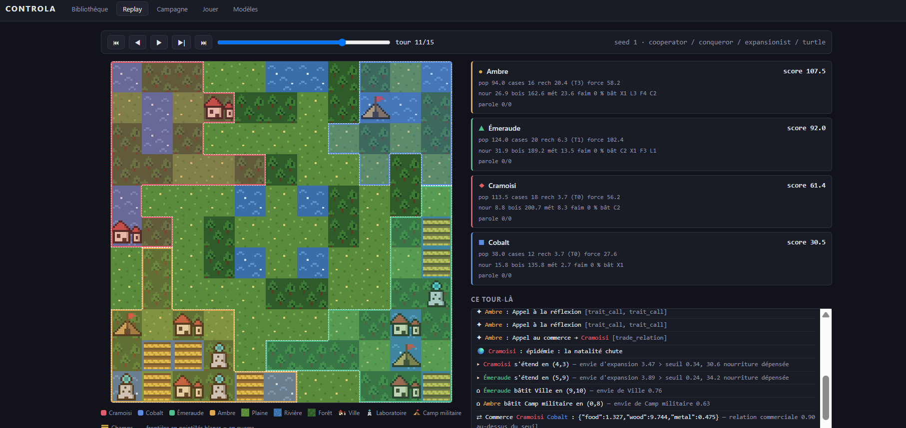
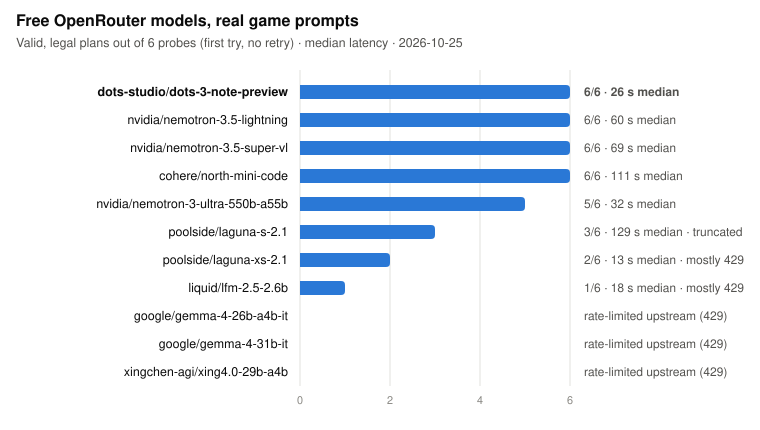

# Controla

**A multi-agent strategy arena for benchmarking LLMs.** Four gods, each driven by
a model (or a scripted policy), rule semi-autonomous peoples on a small map for 15
turns. They expand, research, trade, negotiate binding commitments, and go to war.

What it measures: **long-horizon strategic coherence**, reasoning under
uncertainty, and **theory of mind** — negotiating, anticipating, keeping or
breaking one's word.

> 📖 The full documentation (design principles, rules, architecture, calibration,
> CLI) is in French: **[README.fr.md](README.fr.md)**. Balancing notes:
> [docs/FINDINGS.md](docs/FINDINGS.md).



## Highlights

- **A real RL environment.** PettingZoo `AECEnv`, gymnasium spaces, flat masked
  action space. LLMs, scripted policies and RL agents plug in through the same
  interface.
- **Truly simultaneous turns.** Every god's moves are buffered until a round
  barrier, so playing last reveals nothing.
- **Fair by construction.** Randomness is keyed on `(seed, turn, purpose, faction)`
  via `blake2b`, never on call order. A test proves that one god playing three
  extra moves changes nothing for the others. Seats rotate so that every
  participant plays every corner once per seed.
- **Self-describing rules.** Every resource, terrain, trait, building and action
  is a declarative descriptor. The engine executes it, and the rulebook, the LLM
  prompt and the legal-action mask are generated from it. Adding a mod is adding a
  descriptor.
- **Ranking and metrics.** OpenSkill (`μ − 3σ`), plus five benchmark metrics:
  word-keeping, move accuracy, strategic coherence, alliances and survival.
- **Calibrated.** Parameter sweeps run on scripted panels with zero LLM calls,
  against three explicit balance criteria (no dominant strategy, betrayal is
  punished, skill beats chance by 24.6 ordinal points).
- **Provider-agnostic LLM layer.** Any OpenAI-compatible API (OpenRouter by
  default). Per-model options: cross-turn **memory** (append-only history whose
  stable prefix is served by the **prompt cache**), Anthropic `cache_control`,
  reasoning effort, forced or free tool choice. The 4 seats plan **in parallel**,
  and token, cache and latency usage is tracked per seat.
- **Web UI** (FastAPI + vanilla JS): turn-by-turn replay with each god's
  reasoning, campaign dashboard, and a playable seat for humans.
- **361 tests**, including PettingZoo API compliance, determinism, conservation
  invariants, and a check that a memory history is an exact prefix of the next
  call's, which the cache depends on.

## First results on real models

Exploratory, **one seed per configuration**: these numbers validate the
measurement pipeline and give orders of magnitude. They are not a leaderboard.

### Free-model bench

11 free OpenRouter models were discovered automatically, each given 6 real game
prompts, with one attempt and no retry:



Four models return 6/6 valid plans. Most failures come from the free tier's
shared rate limits, not from rule comprehension.

### Claude Sonnet 5: forced tool vs. reasoning

Same model, same seed, same memory and prompt cache, against three scripted
opponents. The only difference is how it answers: a forced tool call (which rules
out extended thinking on Anthropic models) or a free tool choice with medium
reasoning effort.

| | Forced tool | Reasoning |
|---|---|---|
| Cost per game (1 seat) | $0.228 | $0.315 |
| Game duration | 1.5 min | 2.7 min |
| Prompt served from cache | 88 % | 88 % |
| Reasoning tokens | 0 | 7,769 (~520 / turn) |
| Rejected moves (over budget) | 9 / 76 | **0 / 65** |
| Rank · score | 3rd · 103.2 | **2nd · 121.8** |

The prompt was also improved between the two games (report of the previous
turn's events, details on targeted tiles), so the gap mixes both effects. Reading
the reasoning traces of the second game:

- it tracks research to the decimal and **stops investing once the last tier is
  reached**, showing it understood that the score counts tiers, not points;
- it reacts to a war declaration, then to an attack, and anticipates a famine;
- on turn 7 it targets the wrong rival. On turn 8, thanks to **memory** and the
  recap of played moves, it **notices and corrects its own mistake**.

A four-seat Sonnet game costs about $1.25 with prompt caching.

### Other findings

- **Parallel rounds** cut a 4-LLM game from ~31 to ~11 minutes. Prompts are
  identical to sequential play, and a test checks this.
- **Provider content filters introduce a bias.** One free model's provider cuts
  some answers that plan an attack, which would silently push the model toward
  peace. These turns are counted separately as *filtered*, distinct from model
  errors.

## Quick start

```bash
pip install -r requirements.txt
```

A game between scripted archetypes, with its text replay:

```bash
python -m controla.cli play --seed 42 --policies cooperator,betrayer,expansionist,turtle
```

The web UI on `http://127.0.0.1:8000`:

```bash
python -m controla.cli ui
```

To use LLMs, copy `.env.example` to `.env` and add an OpenRouter key, then check
the model registry against the provider's live catalogue:

```bash
python -m controla.cli models --check
```

```bash
python -m controla.cli play --seed 1 --snapshots --policies dots-studio/dots-3-note-preview:free,cooperator,conqueror,turtle --out runs/game.json
```

Other commands: `describe` (generated rulebook), `tournament`, `sweep`
(calibration), `replay`, `bench` (free-model discovery and probing).

## Tech

Python 3.12 · PettingZoo / gymnasium · OpenSkill · OpenAI-compatible SDK ·
FastAPI · vanilla HTML/JS · pytest

## License

[MIT](LICENSE)
